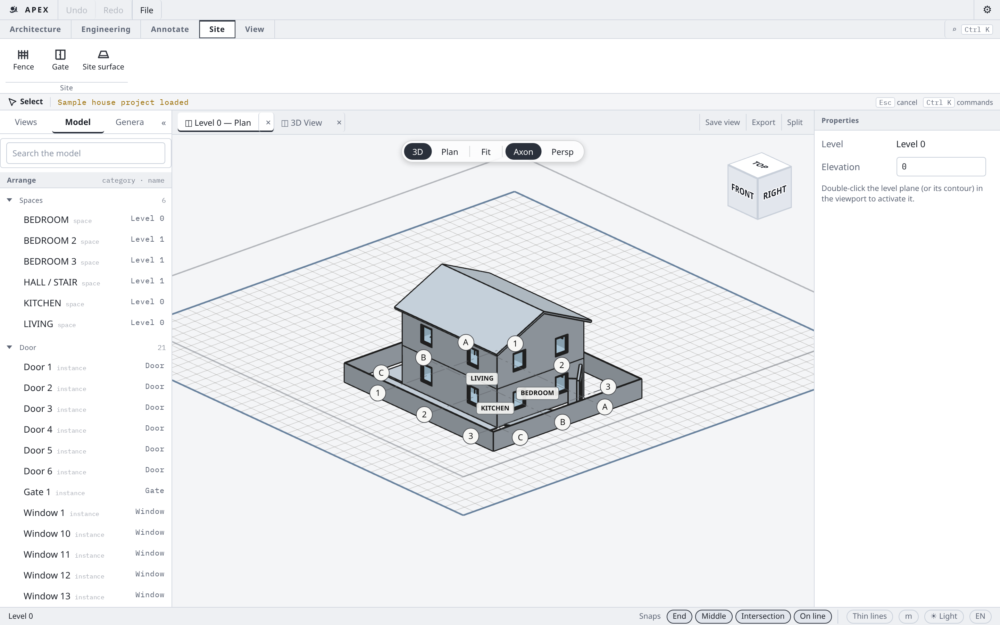
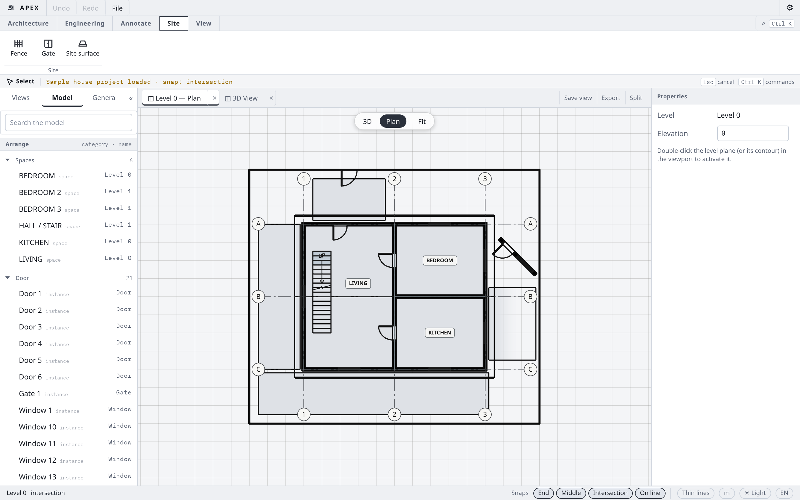
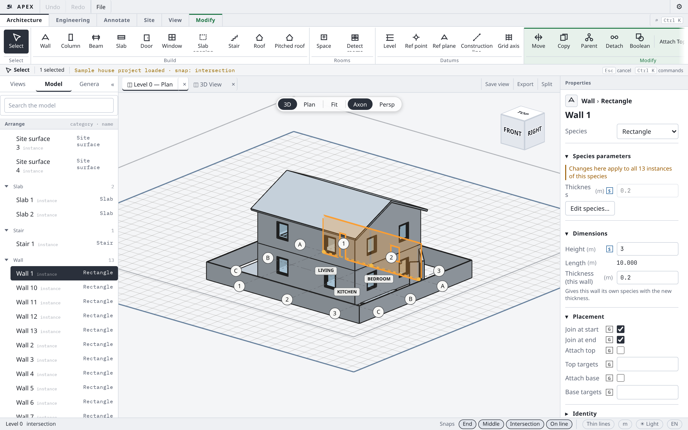
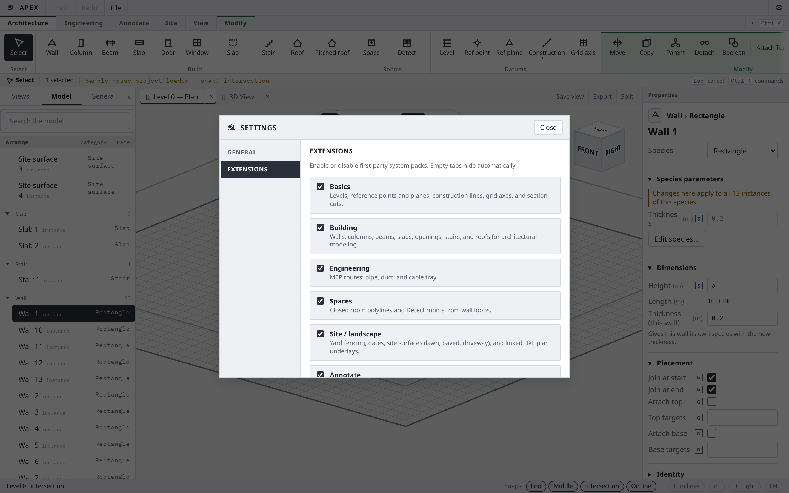

# Apex

Apex is a lightweight **BIM** app for buildings and site work — walls, openings, spaces, fences, and more — running in the **browser** or as a **desktop** install. Under the hood: a **Rust** geometry core compiled to **WASM**, with a **React + WebGL2** shell.

**Try it:** [live demo](https://bkamuz.github.io/apex/) · [desktop Releases](https://github.com/bkamuz/apex/releases)

---

## English

### What you get

- Place building elements (walls, columns, beams, slabs, doors, windows, stairs, roofs) and **spaces**
- **Site / landscape** tools: fence, gate, yard surfaces (lawn, paved, driveway); link a **DXF** as a plan underlay
- Toggle first-party **system packs** in **Settings → Extensions** (Basics, Building, Engineering, Spaces, Site, Annotate, IFC)
- Same UI in the browser and in a **Tauri 2** desktop shell (native Open / Save)
- UI language: English or Russian

Object types are **data** (a component definition), not hard-coded branches — so packs and plugins can add tools without rewriting the core.

<p align="center">
  
</p>

| Plan · yard | Selection · inspector | Settings · Extensions |
| :---: | :---: | :---: |
|  |  |  |

### Try Apex

| Path | How |
| --- | --- |
| **Live demo** | Open [bkamuz.github.io/apex](https://bkamuz.github.io/apex/) — load the sample house from Getting Started |
| **Desktop** | Download installers from [GitHub Releases](https://github.com/bkamuz/apex/releases) (Windows / Linux / macOS). Details: [`apps/desktop/README.md`](apps/desktop/README.md) |
| **Local web** | See [Develop](#develop) below |

**Quick local run** (WASM package is committed, so you can start without a Rust toolchain):

```bash
cd apps/web && npm install && npm run dev
```

Open http://localhost:5173 — then **Load sample house**. Orbit: right-drag · Pan: middle-drag · Zoom: wheel.

**Desktop from source:**

```bash
cd apps/web && npm install
cd ../desktop && npm install && npm run dev
# or from repo root: npm run desktop:dev
```

### Sample project

The built-in sample is a two-storey house with rooms, a pitched roof, and a **yard**: joinable fence loop, gate at the entrance, and mixed site surfaces. Open **Site** in the toolbar for Fence / Gate / Site surface. Graded topography pads are tracked separately and may land after this README snapshot.

### Settings & packs

Gear icon → **Settings**:

- **General** — theme (light / dark / system) and language (EN / RU)
- **Extensions** — enable or disable system packs; empty toolbar tabs hide automatically

See [docs/system-packs.md](docs/system-packs.md) if you want to add a pack.

---

## Русский

### Что это

Apex — лёгкий **BIM**-редактор для зданий и участка: стены, проёмы, помещения, забор и покрытия. Работает в **браузере** и как **десктоп**-приложение. Ядро геометрии на **Rust → WASM**, интерфейс — **React + WebGL2**.

**Попробовать:** [демо](https://bkamuz.github.io/apex/) · [Releases / десктоп](https://github.com/bkamuz/apex/releases)

### Возможности

- Конструкции здания (стены, колонны, балки, плиты, двери, окна, лестницы, кровли) и **пространства**
- Вкладка **Участок / ландшафт**: забор, калитка, покрытия двора; **DXF** как связанная подложка плана
- Системные **пакеты** включаются в **Настройки → Расширения**
- Один и тот же интерфейс в браузере и в оболочке **Tauri 2** (системные диалоги Открыть / Сохранить)
- Язык интерфейса: русский или английский

Типы объектов — это **данные** (определение компонента), а не отдельные ветки в коде.

### Как запустить

| Способ | Как |
| --- | --- |
| **Демо** | [bkamuz.github.io/apex](https://bkamuz.github.io/apex/) — в стартовом окне загрузите образец дома |
| **Десктоп** | Установщики в [Releases](https://github.com/bkamuz/apex/releases). Подробнее: [`apps/desktop/README.md`](apps/desktop/README.md) |
| **Локально** | См. [Develop](#develop) ниже |

```bash
cd apps/web && npm install && npm run dev
```

Откройте http://localhost:5173 — **Загрузить образец дома**. Орбита: ПКМ · Панорама: СКМ · Масштаб: колесо.

### Образец проекта

Двухэтажный дом с помещениями, скатной кровлей и **двором**: замкнутый забор, калитка у входа, разные покрытия. Инструменты участка — вкладка **Участок**. Рельеф (graded topo) развивается отдельно и может появиться позже этой версии README.

### Настройки и пакеты

Иконка шестерёнки → **Настройки**:

- **Общие** — тема и язык
- **Расширения** — системные пакеты; пустые вкладки панели скрываются сами

---

## Architecture

```text
crates/apex-geometry   Geometry kernel: Frame, Curve, Profile, sweep, extrude
crates/apex-core       Document, components, parameters, expressions, Project
crates/apex-wasm       wasm-bindgen façade for the web app
apps/web               Vite + React UI
apps/desktop           Tauri 2 shell (same web UI + native Open/Save)
```

Flow: React tool → WASM command → Rust rebuilds mesh → flat GPU buffers → one WebGL2 draw.

No Three.js scene graph. No Object3D per element.

Legacy JS prototype (Three.js / That Open): branch `archive/js-prototype`.

### Components

An object type is **data**, not code. A `ComponentDefinition` says how it is
placed, what parameters it takes, and how to build its geometry:

```jsonc
{
  "id": "acme.planter",
  "display_name": "Planter",
  "category": "furniture",
  "placement": "point",                     // 1 pick; also two_point, three_point_arc, polyline, path
  "params": [
    { "id": "radius", "label": "Radius", "kind": "length", "default": 0.5 },
    { "id": "height", "label": "Height", "kind": "length", "default": 0.9 }
  ],
  "recipe": {
    "op": "extrude",                        // also sweep, group, custom
    "profile": { "shape": "circle", "radius": { "op": "param", "id": "radius" } },
    "height": { "op": "param", "id": "height" }
  }
}
```

Shipped types use this structure (no bespoke per-type geometry forks in the shell):

| Component | Placement | Recipe |
| --- | --- | --- |
| `apex.wall` | path (line, arc, or polyline) | profile swept along the path, seated on the level |
| `apex.column` | one point | profile extruded up |
| `apex.beam` | two points | rectangle swept, hung below the line |
| `apex.slab` | polyline (double-click to close) | closed boundary extruded for thickness |
| `apex.fence` | path (joinable) | thin profile along the path (Site pack) |
| `apex.gate` | hosted on fence | opening cut in the host fence |
| `apex.site_surface` | closed polyline | thin site region (lawn / paved / driveway) |

A **profile type** is the catalog object behind a `profile` parameter: draw a 2D
section with the mouse, then assign edge dimensions. Type-level values are shared;
instance-level values vary per element. **Edit profile** opens the sketch editor.
The project browser lists **types** and **instances**. **Save** / **Open** persist
the document (also auto-saved in the browser).

Each **tool** is a plugin (`apps/web/src/plugins/`). A plugin decides what the
toolbar shows; registering a component does not automatically add a button.
Draw mode (line / arc / polyline) and section are switches on the tool, not
extra plugins. A user `defineComponent` call is itself a plugin and gets a
default placement tool. The property inspector is generated from the schema.

### Extending a running app

```js
// A module, or the browser console.
window.apex.defineComponent({ /* definition as above */ });
```

`window.apex.registerTool(tool)` adds a toolbar button for a custom gesture.
See `apps/web/src/tools/Tool.ts` and `examples/custom-tool.ts`.

Built-in **Move** (`M`) and **Copy** (`C`) transform the current selection
(instances, references, grid axes, construction lines, section cuts, spaces):
pick a base point, then a target. Move shows a ghost overlay only — the
document updates on the target pick. Undo/redo and project save include the
results.

## Prerequisites

- Rust (stable) + `wasm32-unknown-unknown` + `wasm-pack` (only needed after Rust edits)
- Node.js 20+
- Desktop (optional): [Tauri 2 system deps](https://v2.tauri.app/start/prerequisites/)

```bash
rustup target add wasm32-unknown-unknown
cargo install wasm-pack --version 0.13.1
```

## Develop

```bash
# Rebuild WASM (after Rust changes)
cd apps/web && npm run wasm:build

# Web app
cd apps/web && npm install && npm run dev
```

Open http://localhost:5173

### Desktop (Tauri 2)

Same React + WASM UI in a native window, with system Open / Save / Save As.
Details: [`apps/desktop/README.md`](apps/desktop/README.md).

```bash
cd apps/web && npm install
cd ../desktop && npm install && npm run dev
# or from repo root: npm run desktop:dev
```

Production package:

```bash
npm run desktop:build
```

CI builds Windows (x64 + arm64), Linux (x64 + arm64), and macOS (arm64 +
Intel cross-compile) via [`.github/workflows/desktop.yml`](.github/workflows/desktop.yml).
**Actions artifacts** (14-day) appear on each Desktop workflow run; **GitHub
Releases** are created when you push a `v*` / `desktop-v*` tag, or run the
workflow with **publish_draft**. Cut a release:
`git tag v0.1.0 && git push origin v0.1.0`.

### Live demo (GitHub Pages)

After merging to `main` and enabling Pages (Settings → Pages → **GitHub Actions**):

**https://bkamuz.github.io/apex/**

Each push to `main` redeploys via `.github/workflows/deploy-pages.yml`.

### Demo walkthrough

1. Pick a tool. **Basics** / Architecture datums: **Level**, **Ref point** (the only point tool), **Ref plane**, **Construction line**, **Grid axis**, **Section cut**. Building tools: **Wall**, **Column**, **Beam**, **Slab**, openings, roofs. **Engineering**: Pipe / Duct / Cable tray. **Spaces**: closed **Space** polyline. **Site**: Fence / Gate / Site surface. With Wall or Fence active, switch **Line** / **Arc** / **Polyline** as offered.
2. Click the points that mode needs; a ghost previews the result. Finish polylines with double-click or Enter.
3. Select an element. **This element** vs **Shared type** fields; **Edit profile** for the 2D sketch. Grid axes, construction lines, section cuts, and spaces edit from the same inspector pattern.
4. The left **Project** browser lists types, instances, references, grids, annotations, and spaces. **Save** downloads the project (also stored in the browser); **Open** loads a file; **New** starts over.
5. Orbit: right-drag · Pan: middle-drag · Zoom: wheel · Shift: snap to grid.

**Grid axes:** segment on the level (plan XZ); each axis is a vertical datum plane through that segment and world up.

**Construction lines / section cuts / spaces:** [`PlanAnnotation`](crates/apex-core/src/annotation.rs) entities on the active level (olive guides / amber cut hint / teal space boundary). Section-cut MVP is overlay-only (no 3D clip view yet).

## Tests

```bash
cargo test -p apex-core -p apex-geometry   # unit tests
npm run typecheck                          # tsc
npm run dev                                # then, in another shell:
npm run test:smoke                         # Playwright end-to-end
```

Regenerate the README gallery (dev server running):

```bash
APEX_SMOKE_URL=http://localhost:5173/ \
  APEX_README_OUT=/tmp/readme-shots \
  APEX_README_DOCS=docs/images \
  node apps/web/scripts/readme-screenshots.mjs
```

### Plugin-first extensibility

Every toolbar tool is a plugin (`apps/web/src/plugins/`). First-party plugins
are grouped into **system packs** with Settings checkboxes. See
[docs/system-packs.md](docs/system-packs.md). New object types are
`ComponentDefinition` data. File formats register through `registerExporter` /
importers. Do not add per-type branches in `App.tsx` / `apex-wasm` — extend a seam.

```js
window.apex.defineComponent({ /* … */ });
window.apex.registerTool(tool);
window.apex.registerExporter({ id, label, filename, descriptor: { purpose: '…' }, export: () => '…' });
window.apex.registerAnnotationKind({
  kind: 'text_note',
  descriptor: { purpose: '…' },
  tools: [/* Tool that calls ctx.createViewAnnotation on a saved view */],
  hitTest(annotation, x, y, renderer) { /* optional */ return false; },
  serialize: (kind) => kind,
  deserialize: (payload) => payload,
});
```

Every component, tool, exporter, plugin and annotation kind **must** carry a
`descriptor` (`purpose`, optional `examples`, `units`, `constraints`); registration
fails without one. See [docs/descriptors.md](docs/descriptors.md).
UI language (EN/RU) and plugin `t()` usage: [docs/i18n.md](docs/i18n.md).

View-owned annotations (dimensions, notes) register through `registerAnnotationKind`.
See `examples/custom-annotation.ts`.

**IFC:** Export **IFC** writes IFC4 with tessellated meshes; type → entity mapping
comes from each definition's `ifc_entity`. **Open** accepts `.ifc` (plugin importer):
storeys → levels; triangulated / faceted / extruded products → `apex.ifc.mesh`
instances. Still mesh-only — no parametric round-trip.

## Roadmap (not in this MVP)

- Full associativity when a reference moves
- Visual component editor (build components without JSON)
- Full CAD constraint solver (sketch is polyline + labeled edge lengths today)
- csgrs / full CSG booleans (openings use AABB punch; SMLib worker available via `?kernel=smlib`)
- Richer IFC import; optional IfcOpenShell sidecar
- Auto-update / signed desktop releases; community plugin marketplace
- Rotate / mirror / array transforms; richer MEP fittings
- Graded topography / civil TIN beyond the current yard surfaces

## Geometry kernels

Wall and slab openings are subtracted by a pluggable `GeometryKernel`
(`apex-geometry`). Default: mesh / layered-solid path. Exact B-rep on vendored
[SMLib](third_party/smlib/README.md) runs in a Web Worker (`?kernel=smlib` or
`__apexTest.setKernel('smlib')`). Parity tests:
`cargo test -p apex-core --test kernel_parity`.

## License

MIT. Third-party code keeps its own license: `third_party/smlib` (SMLib,
Apache-2.0, see its `NOTICE`), `third_party/boolmesh`.
