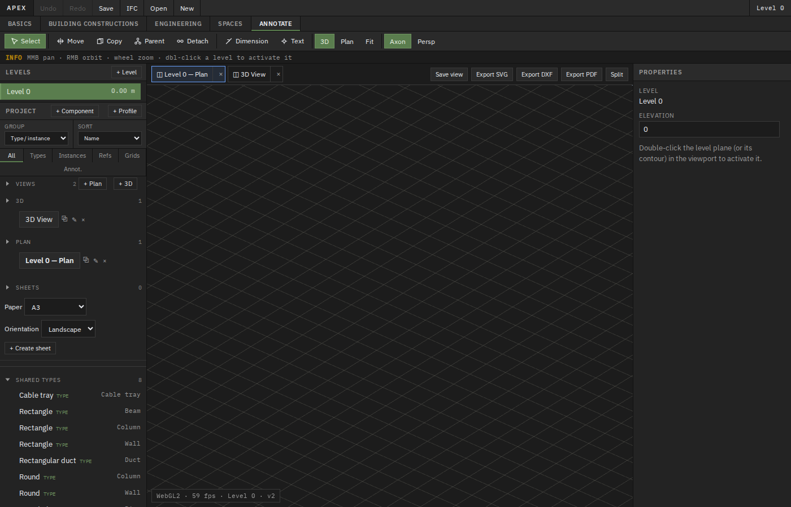
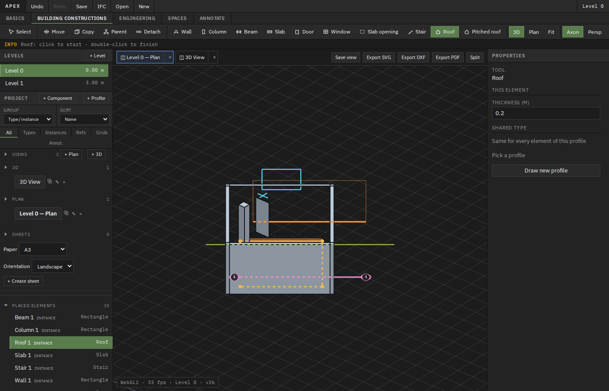
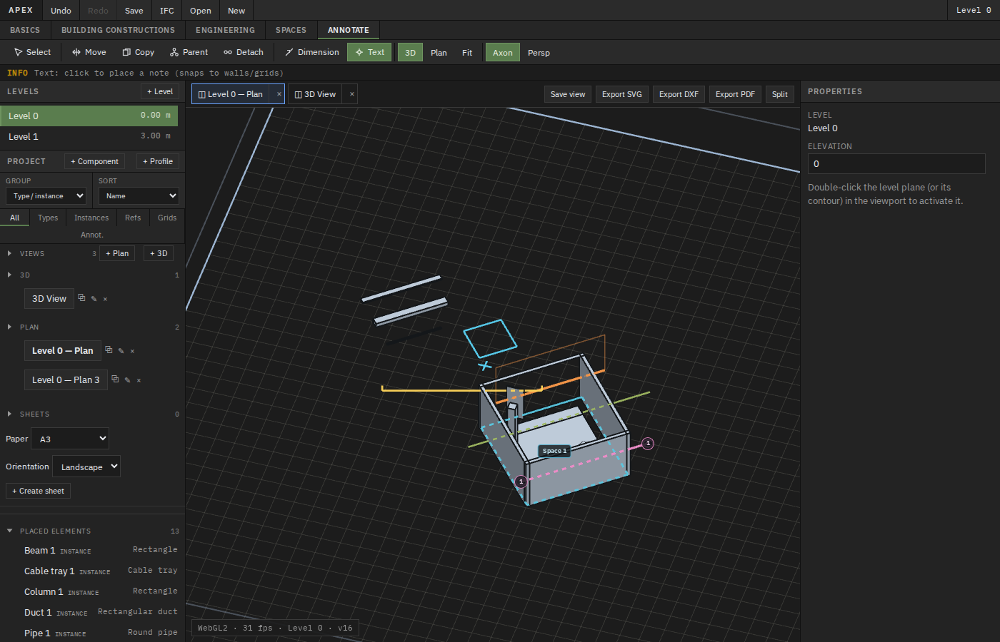
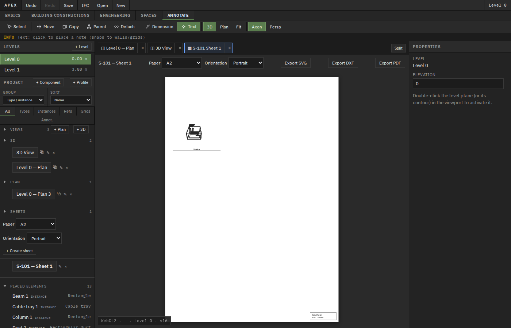
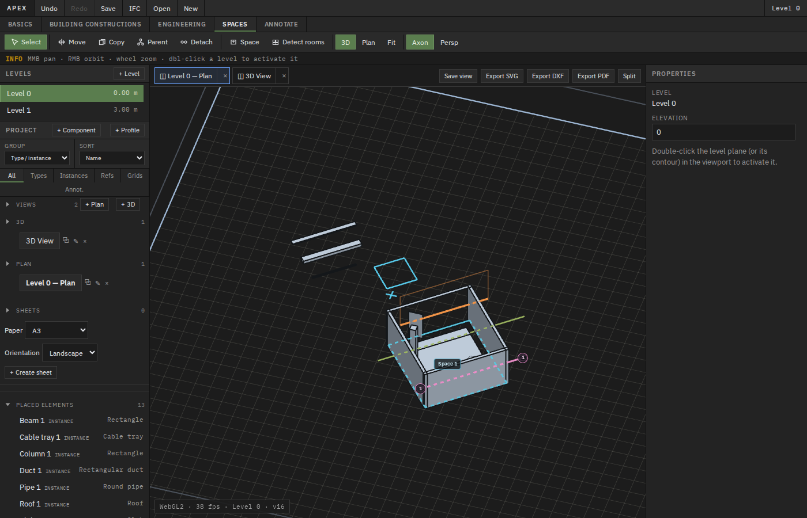
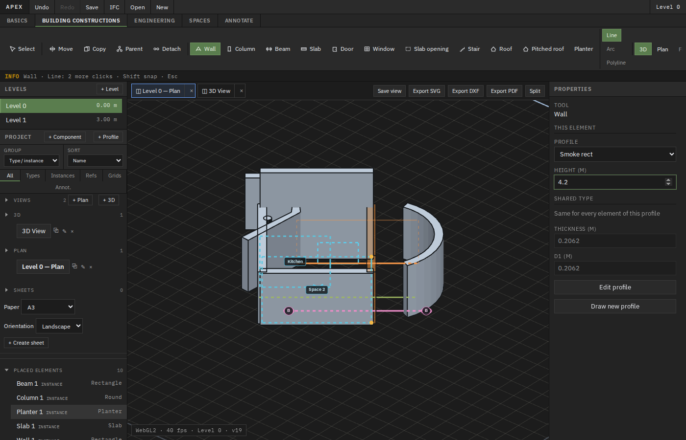
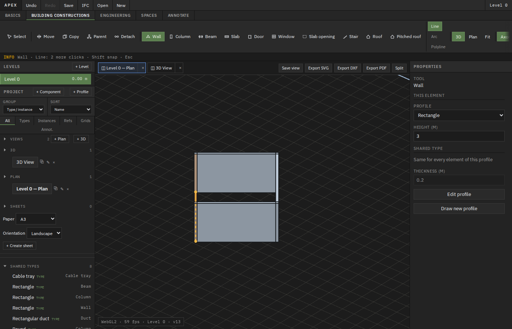
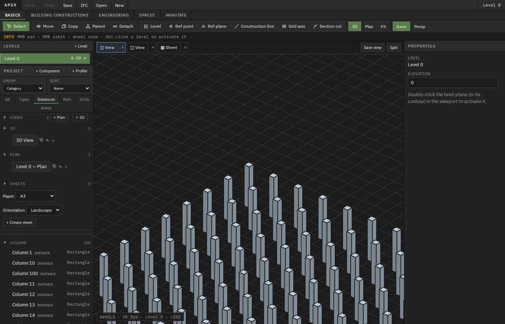

# Apex web app — full functional & visual audit (2026-10-25)

**Branch audited:** `cursor/saved-views-sheets-e9ed` (PR #87 views/sheets on top of main)  
**Environment:** Vite dev server `http://localhost:5173/`, Chromium via Playwright (1400×900, plus 820×620 narrow pass)  
**Evidence:** `docs/audit-2026-10-25/` (27 step screenshots, smoke screenshots, export samples, `full-audit-walkthrough.webm`, `findings.json`)

## Executive summary

| Severity | Count | Notes |
|----------|------:|-------|
| **Blocker** | 0 | No crash/data-loss blockers observed in scripted flows |
| **Major** | 2 | Parent tool viewport workflow; profile holes not exposed in UI |
| **Minor** | 3 | Sheet PDF export path; view export discoverability; delete UX for runtime components |
| **Polish** | 6+ | Hosted pick sensitivity, toolbar density, export labeling, etc. |

**Automated checks:** `npm run test:smoke` — **all passed** (full plugin toolbar, inspector, profile/component editors, persistence, parent via WASM API).  
**Custom audit script:** `docs/audit-2026-10-25/run-full-audit.mjs` (run from `apps/web`: `APEX_AUDIT_OUT=../../docs/audit-2026-10-25 node ../../docs/audit-2026-10-25/run-full-audit.mjs`).  
**Camera regression:** `node scripts/camera-controls-test.mjs` — **all passed**.

---

## Feature status (summary table)

Status legend: **Works** · **Partly** · **Broken** · **Confusing** · **N/T** (not tested this run)

| Area | Item | Hotkey | Status | Severity | Evidence |
|------|------|--------|--------|----------|----------|
| **Global** | App load / WebGL2 | — | Works | — | `001-startup-default-view.png` |
| | Undo / Redo (UI + Ctrl+Shift+Z) | — | Works | — | smoke + `015-transform-undo-redo.png` |
| | Save / reload persistence | — | Works | — | smoke `apex-07-browser-save.png`, `024-persistence-after-reload.png` |
| | New project | — | Works | — | `025-new-project-cleared.png` |
| | Open project (JSON file) | — | N/T | — | Control exists (`open-project`); file picker not exercised |
| | IFC export | — | Works | — | `exports/model.ifc` (~50 KB, IFC4 header) |
| | Browser console errors | — | Works | — | No errors in audit session |
| | ~100 instances performance | — | Works | — | 100 columns, ~1.7s reload (`027-perf-100-columns.png`) |
| | Narrow layout 820px | — | Works | — | `026-narrow-viewport-820.png` |
| **Pinned tools** | Select | — | Works | — | smoke selection / anchor drag |
| | Move | **M** | Works | — | smoke ghost preview + commit |
| | Copy | **C** | Works | — | smoke |
| | Parent | **P** | **Broken** (UI) | Major | `016-parent-column-to-wall.png`; WASM API works (smoke) |
| | Detach | — | Partly | Minor | Activates; UI pick flow not re-verified end-to-end |
| **Basics** | Level | — | Works | — | `002-basics-level-added.png` |
| | Ref point | — | Works | — | smoke §3 |
| | Ref plane | — | Works | — | `003-basics-refs.png` |
| | Construction line | — | Works | — | `004-basics-annotations.png` |
| | Grid axis | — | Works | — | smoke §3b |
| | Section cut | — | Works | — | smoke §3d (overlay-only MVP) |
| **Building** | Wall (Line / Arc / Polyline) | — | Works | — | smoke §2–4, join screenshots |
| | Column (rect/round profile param) | — | Works | — | smoke §6 |
| | Beam | — | Works | — | smoke §4 |
| | Slab | — | Works | — | smoke §4 + thickness inspector |
| | Door (hosted) | — | Partly | Polish | Needs accurate wall hit (`006-building-door-on-wall.png`) |
| | Window (hosted) | — | Partly | Polish | Placed in audit; inspector not re-checked |
| | Slab opening | — | Partly | Polish | `007-building-slab-opening.png`; host cut not visually verified |
| | Stair | — | Partly | Polish | Placed (`008-building-mixed-model.png`); params not edited |
| | Roof / Pitched roof | — | Partly | Polish | Placed; pitched builder not stress-tested |
| **Engineering** | Pipe / Duct / Cable tray | — | Works | — | `009-engineering-mep.png`, smoke |
| **Spaces** | Space (manual polyline) | — | Works | — | smoke `apex-spaces-placed.png` |
| | Detect rooms | — | Works | — | `010-spaces-detect-rooms.png` |
| **Annotate** | Linear dimension | **D** | Works | — | `018-annotate-dimension-text.png` (requires saved plan view) |
| | Text note | **N** | Works | — | prompt accepts label |
| **Viewport** | Plan / 3D | — | Works | — | `011-viewport-plan-mode.png`, `012-viewport-3d-mode.png` |
| | Fit | — | Works | — | Used in audit |
| | Axon / Persp | — | Works | — | `013-camera-perspective.png`; camera script |
| | Orbit / pan / zoom | — | Works | — | camera-controls-test |
| **Views** | Views & sheets panel | — | Works | — | `017-views-new-plan.png` |
| | New plan / 3D view | — | Partly | Polish | Plan created; 3D view row not explicitly added in audit |
| | Document tabs / close | — | Works | — | smoke + audit |
| | Save view | — | Works | — | audit flow |
| | Split pane | — | Partly | Polish | `019-views-split.png`; second pane not deeply exercised |
| **Sheets** | New sheet (A2 portrait) | — | Works | — | `020-sheet-viewport-placed.png` |
| | Drag view → viewport | — | Works | — | same |
| | Viewport scale | — | Partly | Polish | Scale dropdown changed; numeric readback not asserted |
| | Polygon crop | — | Partly | Polish | Handle dragged; reset not clicked |
| | Viewport title | — | Partly | Polish | `viewport-title-*` present; text not edited |
| | Sheet SVG export | — | Works | — | `exports/sheet.svg` |
| | Sheet DXF export | — | Works | — | `exports/sheet.dxf` |
| | Sheet PDF export | — | **Confusing** | Minor | Opens print preview, no Playwright download |
| | View SVG/DXF/PDF | — | Works* | Polish | *Only when **plan** document tab active (hidden on sheet tab) |
| **Editors** | Profile sketch + constraints | — | Works | — | smoke `apex-06-profile-editor.png` |
| | Profile holes | — | **Partly** | Major | Geometry supports holes; **no UI** to author inner loops |
| | Component editor | — | Works | — | smoke `apex-08-component-editor.png` |
| **Browser** | Filters (all/types/instances/…) | — | Works | — | smoke §11 |
| | Group by category / sort | — | Works | — | `023-browser-group-sort-filter.png` |
| | New component / profile | — | Works | — | smoke |
| **Themes** | Light/dark toggle | — | N/T | — | App uses fixed dark `color-scheme`; no theme switch found |

---

## Toolbar inventory (source + UI)

Registration: `apps/web/src/plugins/catalog.ts`, tabs: `apps/web/src/tools/tabs.ts`.

| Tab | Create / transform tools (excluding view chrome) |
|-----|---------------------------------------------------|
| **Basics** | Level, Ref point, Ref plane, Construction line, Grid axis, Section cut |
| **Building constructions** | Wall (+ Line/Arc/Polyline modes), Column, Beam, Slab, Door, Window, Slab opening, Stair, Roof, Pitched roof |
| **Engineering** | Pipe, Duct, Cable tray |
| **Spaces** | Space, Detect rooms |
| **Annotate** | Dimension (`apex.dimension`), Text (`apex.text_note`) |
| **Pinned (all tabs)** | Select, Move (**M**), Copy (**C**), Parent (**P**), Detach |
| **View chrome (all tabs)** | 3D, Plan, Fit, Axon, Persp |
| **Top bar** | Undo, Redo, Save, Open, New, IFC export |

Built-in components (`crates/apex-core/src/registry.rs`): `apex.wall`, `apex.column`, `apex.beam`, `apex.slab`, `apex.door`, `apex.window`, `apex.slab_opening`, `apex.stair`, `apex.roof`, `apex.roof.pitched`, `apex.pipe`, `apex.duct`, `apex.cable_tray`.

---

## Prioritized issues

### Major

1. **F-010 — Parent tool: canvas picks do not attach parent**  
   - **Repro:** Building → place wall + column → **Parent** → click column in browser → click wall on canvas (plan or 3D).  
   - **Expected:** `parent_id` set on column.  
   - **Actual:** `parent_id` remains null (`016-parent-column-to-wall.png`).  
   - **Note:** `apexSetElementParent` via WASM **works** (smoke `[parent]` section) — gap is **tool gesture / picking**, not core data model.

2. **F-019 — Profile holes not authorable in UI**  
   - **Repro:** Wall → Draw new profile → sketch outer loop only.  
   - **Expected:** Way to add hole loops (types expose `holes` in `ProfilePreviewDto`).  
   - **Actual:** No hole workflow in `ProfileEditor.tsx`; geometry layer supports holes (`apex-geometry` profile tests).

### Minor

3. **Sheet PDF export uses print dialog** (`SheetPaperView.onExportPdf` → `openSvgForPrint`) — not a file download; automation sees “no download”. Users may expect a `.pdf` file like DXF/SVG.

4. **View export buttons only when active tab is a saved plan view** (`showViewExport={activeViewIsPlan}`) — correct but easy to miss while on a sheet tab (audit false negative).

5. **Delete key** — smoke covers delete for selections; audit did not remove `audit.box` component (selection/name mismatch). Manual delete from browser not re-tested.

### Polish

6. **Hosted door/window** — placement succeeds only near wall centerline; misses feel like tool failure.  
7. **Toolbar lists view controls alongside tools** — crowded labels (see `toolbar-inventory.json`).  
8. **Section cut** — plan overlay only; no 3D clip / dedicated section view (documented MVP).  
9. **Split view** — toggled on/off; secondary pane interaction not validated.  
10. **Sheet viewport live canvas** — SVG export showed paper frame; verify rich geometry in viewport when model is heavy (pixel spot-check passed in `sheet-e2e-user-flow.mjs` pattern).

---

## Recommended fix order

1. **Parent tool picking** — align with `pickElementId` / saved-view camera mode (consider `onPointerDown` like other tools, or unify pick pipeline). Re-run smoke parent UI pick test (extend smoke beyond WASM-only).  
2. **Profile holes UX** — add inner-loop authoring to `ProfileEditor` (or defer with explicit “holes not supported yet” in UI).  
3. **Sheet PDF** — either trigger download (client PDF lib) or rename control to “Print PDF…” to match behavior.  
4. **View export discoverability** — disable with tooltip on sheet tab (“Switch to a plan view to export”) or show exports in sheet context when appropriate.  
5. **Hosted placement feedback** — snap/highlight valid host segments when hover with Door/Window/Slab opening.  
6. **Regression tests** — extend `sheet-e2e-user-flow.mjs` for PDF print path; add Parent **UI** pick test (not only WASM).

---

## Key screenshots

**Walkthrough video:** [full-audit-walkthrough.webm](audit-2026-10-25/full-audit-walkthrough.webm)

---

## Export file inspection

| File | Result |
|------|--------|
| `exports/model.ifc` | Valid IFC4 SPFF header, project + units present |
| `exports/sheet.svg` | A2 sheet frame, title `Sheet S-101` |
| `exports/sheet.dxf` | Non-empty DXF text (452 B) |
| View SVG/DXF/PDF | Generated when plan document tab active (verified separately) |

---

## Panels & inspector (source reference)

| Panel | Location | Notes |
|-------|----------|-------|
| Project browser | `ProjectBrowser.tsx` | Filters, group, sort, tree kinds: instance, type, reference, grid_axis, construction_line, section_cut, space, view, sheet, component_def |
| Properties | `PropertiesPanel.tsx` | Schema-driven instance + type blocks; Edit profile / New profile |
| Views & sheets | `ViewsSheetsPanel.tsx` | New plan/3D, save list, sheet rows, paper size/orientation |
| Document tabs | `ViewTabBar.tsx` | Save view, split, view exports (plan only) |
| Level list | `App.tsx` topbar | Manage levels; Level tool adds +3 m storey |
| Component / profile editors | Modal overlays | `data-testid` hooks for automation |

---

*Audit performed 2026-10-25. No product code was modified on this branch; documentation and evidence only.*
